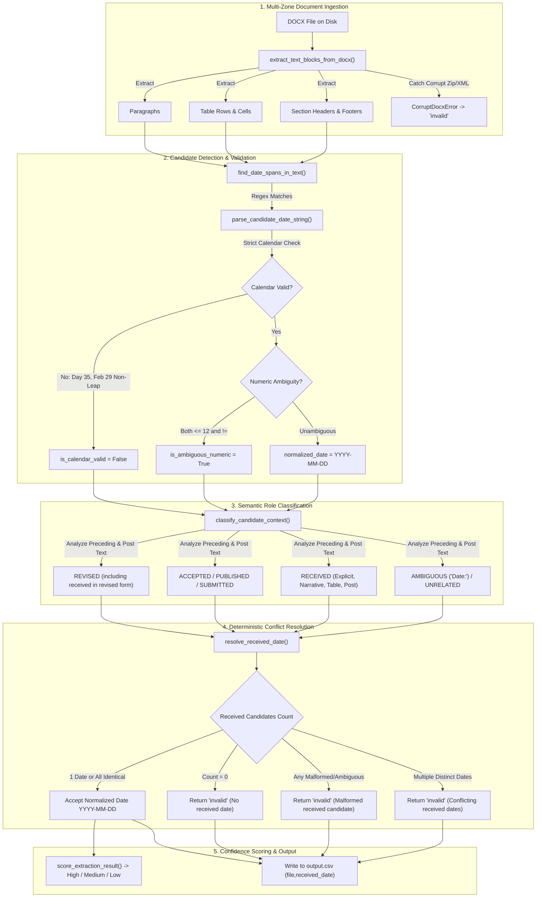

# Manuscript Received-Date Extraction and Automated Quality Testing

ManuSure is an enterprise-grade, deterministic command-line application and automated quality assurance suite designed to extract the **received date** from academic manuscripts in Microsoft Word (`.docx`) format, normalize the dates to standard ISO 8601 (`YYYY-MM-DD`), and generate a clean, RFC 4180-compliant CSV report.

The system is built entirely with Python standard libraries, `python-docx`, and `python-dateutil`. It operates **100% offline**, requiring **no LLMs, cloud APIs, external microservices, or machine learning models**.

---

## Table of Contents

1. [Executive Summary & Core Principles](#1-executive-summary--core-principles)
2. [Technology Stack & System Requirements](#2-technology-stack--system-requirements)
3. [Repository Structure](#3-repository-structure)
4. [Installation & Setup](#4-installation--setup)
5. [Command-Line Usage & Evaluation (`run.sh`)](#5-command-line-usage--evaluation-runsh)
6. [Input & Output CSV Contracts](#6-input--output-csv-contracts)
7. [System Architecture & Ingestion Pipeline](#7-system-architecture--ingestion-pipeline)
8. [Deterministic Rule-Based NLP Extraction Engine](#8-deterministic-rule-based-nlp-extraction-engine)
   - [8.1 Multi-Zone Document Parsing](#81-multi-zone-document-parsing)
   - [8.2 Date Candidate Identification](#82-date-candidate-identification)
   - [8.3 Calendar Validation & Leap Year Logic](#83-calendar-validation--leap-year-logic)
   - [8.4 Numeric Ambiguity Resolution ($D \le 12 \land M \le 12$)](#84-numeric-ambiguity-resolution-d-le-12-land-m-le-12)
   - [8.5 Context Windowing & Semantic Role Classification](#85-context-windowing--semantic-role-classification)
   - [8.6 Deterministic Conflict Resolution Truth Table](#86-deterministic-conflict-resolution-truth-table)
9. [Confidence Scoring Framework](#9-confidence-scoring-framework)
10. [Exhaustive Date Format Reference Table](#10-exhaustive-date-format-reference-table)
11. [Automated Testing Engine (Pytest)](#11-automated-testing-engine-pytest)
12. [Quality Assurance Verification Report (`test_report.csv`)](#12-quality-assurance-verification-report-test_reportcsv)
13. [Resilience, Fault Tolerance & Edge Cases](#13-resilience-fault-tolerance--edge-cases)
14. [Troubleshooting & Frequently Asked Questions (FAQ)](#14-troubleshooting--frequently-asked-questions-faq)

---

## 1. Executive Summary & Core Principles

In academic publishing workflows, manuscripts arrive with diverse typesetting structures: metadata may reside in editorial headers, unformatted first-page paragraphs, multi-column tables, or footnotes. Manuscripts often record several dates in proximity:
- **Received date**: When the editorial office originally received the manuscript.
- **Revised date(s)**: When revisions or author corrections were received.
- **Accepted date**: When the peer-review process completed and the editor accepted the work.
- **Published date**: When the online or print article was released.
- **Submission date**: When an author submitted an initial draft (which may differ from formal editorial receipt).

### Core Engineering Principles:
1. **Zero Hallucination / Zero Guessing**: The engine never invents or guesses an ambiguous date. If evidence is ambiguous, malformed, or conflicting, it returns the literal string `invalid`.
2. **Deterministic & Explainable**: The extraction logic relies on explicit regular expressions, contextual proximity boundaries, and strict calendar validation rules. Every extraction decision produces an internal audit trail with reasons and confidence tiers.
3. **Resilient Batch Processing**: A corrupted, truncated, or password-protected DOCX file will **never crash** a batch run. Corrupted files produce `invalid` for that file, and processing immediately proceeds to the remaining documents.
4. **Strict Schema Compliance**: The output CSV contains exactly `file,received_date`. No diagnostic, confidence, or evidence columns pollute the public evaluation contract.

---

## 2. Technology Stack & System Requirements

- **Runtime**: Python 3.12 (fully compatible with Python 3.11+)
- **Target Operating System**: Clean Ubuntu Linux (also verified across Windows 11 with POSIX Git Bash)
- **Primary Dependencies** (defined in [`requirements.txt`](file:///requirements.txt)):
  - `python-docx>=1.1.0`: Native binary parsing of Microsoft Word OpenXML packages.
  - `python-dateutil>=2.8.2`: Lightweight date utilities.
  - `pytest>=8.0.0`: Comprehensive unit, edge-case, and integration test execution.
- **Standard Library Modules**: `re`, `csv`, `datetime`, `pathlib`, `sys`, `shutil`, `tempfile`, `zipfile`.
- **Shell**: Bash 4.0+ (POSIX-compliant execution script).

---

## 3. Repository Structure

The project maintains a clean, decoupled architecture where extraction logic, command-line interface, test automation, and evaluation scripts are strictly separated:

```text
ManuSure/
├── run.sh                     # POSIX evaluation script (executable, LF line endings)
├── main.py                    # Production CLI entrypoint (argument parsing & CSV export)
├── requirements.txt           # Minimal third-party dependencies
├── README.md                  # Comprehensive technical documentation
├── test_report.csv            # Automated QA report generated from live test execution
├── generate_test_report.py    # Independent test harness producing test_report.csv
├── .gitattributes             # Git LF line-ending enforcement for shell & python scripts
├── .gitignore                 # Exclusion rules for virtual environments, caches, & locks
├── manusure/                  # Core Production Package
│   ├── __init__.py            # Package interface and public exports
│   ├── models.py              # Strongly-typed Dataclasses and Enums
│   ├── docx_reader.py         # Multi-zone DOCX text extraction (paragraphs, tables, headers, footers)
│   ├── date_validator.py      # Regex span matching, calendar bounds, leap years, ambiguity logic
│   ├── nlp_extractor.py       # Pre/post-context analysis, role classification, conflict resolution
│   ├── confidence.py          # Deterministic confidence scoring & documented tier assignment
│   └── core.py                # Public APIs: extract_received_date & process_directory
└── tests/                     # Automated Test Suite (74 Pytest Tests)
    ├── __init__.py
    ├── conftest.py            # Dynamic DOCX generators & corruption fixtures
    ├── test_extraction.py     # Semantic role classification & competing date tests
    ├── test_date_formats.py   # Date variations, calendar bounds, leap years, whitespace
    ├── test_edge_cases.py     # Conflicting dates, identical mentions, scoring verification
    ├── test_docx_processing.py# Tables, headers, footers, corruption resilience, temp files
    └── test_cli.py            # CLI argument handling, exit codes, sorting, CSV formatting
```

---

## 4. Installation & Setup

### 4.1 On a Clean Ubuntu Machine

```bash
# 1. Update package index and ensure Python 3.12 and pip are installed
sudo apt-get update
sudo apt-get install -y python3 python3-pip python3-venv

# 2. Clone or navigate to the repository directory
cd ManuSure

# 3. Create and activate an isolated virtual environment
python3 -m venv .venv
source .venv/bin/activate

# 4. Install production and test dependencies
pip install --upgrade pip
pip install -r requirements.txt
```

### 4.2 On Windows (PowerShell or Git Bash)

```powershell
# In PowerShell:
python -m venv .venv
.\.venv\Scripts\Activate.ps1
pip install -r requirements.txt
```

---

## 5. Command-Line Usage & Evaluation (`run.sh`)

The root-level [`run.sh`](file:///run.sh) script is the official entrypoint for evaluation. It automatically verifies argument count, ensures the input directory exists, identifies or bootstraps a Python environment, installs missing dependencies from `requirements.txt` if necessary, executes the extraction pipeline, and propagates exit codes.

### 5.1 Setting Executable Permissions
```bash
chmod +x run.sh
```

### 5.2 Evaluator Command Syntax
```bash
./run.sh <input_folder> <output.csv>
```

### 5.3 Concrete Examples

**Batch Processing Manuscripts:**
```bash
./run.sh ./sample_manuscripts ./final_report.csv
```

**Executing via Python directly:**
```bash
python main.py ./sample_manuscripts ./final_report.csv
```

### 5.4 Exit Code Specifications
- `Exit Code 0`: Processing completed successfully; output CSV written.
- `Exit Code 1`: Invalid arguments provided, input directory missing, or unrecoverable system failure.

---

## 6. Input & Output CSV Contracts

### 6.1 Input Folder Requirements
- The input path must be a valid directory.
- Only files ending with `.docx` (case-insensitive) located directly inside the input folder are processed.
- Subdirectories are **not** recursed into.
- Temporary Microsoft Word lock files starting with `~$` (e.g. `~$paper.docx`) are automatically skipped.
- Input files are sorted in **deterministic alphabetical order** (`sorted(files, key=lambda p: p.name)`).

### 6.2 Output CSV Contract
The output CSV is strictly formatted according to RFC 4180 with UTF-8 encoding:

```csv
file,received_date
manuscript_alpha.docx,2025-01-15
manuscript_beta.docx,2024-11-20
manuscript_gamma.docx,invalid
```

#### Schema Rules:
1. **Header**: Exactly `file,received_date` (no leading/trailing whitespace).
2. **Column 1 (`file`)**: Basename of the file (e.g. `paper1.docx`), never an absolute or relative directory path. Filenames containing commas, spaces, or quotes are properly escaped with RFC 4180 double-quoting.
3. **Column 2 (`received_date`)**: Either an ISO 8601 normalized date in `YYYY-MM-DD` format (e.g., `2025-01-15`), or the literal string `invalid`.
4. **Row Invariance**: Every eligible DOCX document directly in the input folder generates **exactly one row**. An empty input folder produces a valid CSV containing only the header row.
5. **Zero Pollution**: Internal confidence scores, extraction statuses, and evidence snippets are excluded from the output CSV.

---

## 7. System Architecture & Ingestion Pipeline

The ManuSure pipeline processes documents through 5 distinct, decoupled stages:



---

## 8. Deterministic Rule-Based NLP Extraction Engine

### 8.1 Multi-Zone Document Parsing
Document layout variations make single-paragraph extraction unreliable. [`manusure/docx_reader.py`](file:///manusure/docx_reader.py) extracts text blocks from four distinct document zones:
1. **Paragraphs**: Body text, titles, subtitles, and introductory remarks.
2. **Tables**:
   - Individual cell contents.
   - **Composite Row Representations**: Colonnaded cells such as `[ "Received", "15 January 2025" ]` are concatenated as `"Received: 15 January 2025"` and pipe-delimited as `"Received | 15 January 2025"`. This ensures label-value associations spanning adjacent cells remain intact.
3. **Section Headers**: Recurring journal running headers where received dates are frequently stamped.
4. **Section Footers**: First-page or running document footers containing publishing metadata.

### 8.2 Date Candidate Identification
[`manusure/date_validator.py`](file:///manusure/date_validator.py) identifies candidate date spans in running text without requiring external tokenizers. Four comprehensive regular expression suites are evaluated:

| Format Family | Pattern Regex | Examples Matched |
| :--- | :--- | :--- |
| **Day Month Year (DMY)** | `\b([0-3]?\d)(?:st\|nd\|rd\|th)?[\s\-]+([A-Za-z]+)\.?[\s\-]+([12]\d{3})\b` | `15 January 2025`, `15 Jan 2025`, `15th Jan 2025`, `15-Jan-2025` |
| **Month Day Year (MDY)** | `\b([A-Za-z]+)\.?[\s\-]+([0-3]?\d)(?:st\|nd\|rd\|th)?(?:,)?[\s\-]+([12]\d{3})\b` | `January 15, 2025`, `Jan 15, 2025`, `Jan. 15, 2025`, `January 15th, 2025` |
| **ISO 8601** | `\b([12]\d{3})[-/.](0?[1-9]\|1[0-2])[-/.](0?[1-9]\|[12]\d\|3[01])\b` | `2025-01-15`, `2025/01/15`, `2025.01.15` |
| **Pure Numeric** | `\b([0-3]?\d)[-/.]([0-3]?\d)[-/.]([12]\d{3})\b` | `15/01/2025`, `01/02/2025`, `15-01-2025`, `15.01.2025` |

### 8.3 Calendar Validation & Leap Year Logic
Every candidate date is validated using Python's `datetime.date(year, month, day)`:
- **Year Bounds**: Only realistic manuscript years ($1900 \le \text{Year} \le 2099$) are accepted.
- **Month Bounds**: Validated strictly between $1$ and $12$. Textual months are mapped against a full dictionary containing full names (`january`–`december`) and abbreviations (`jan`–`dec`, `sept`).
- **Day Bounds by Month**:
  - 30-day months (April, June, September, November): Days $> 30$ are rejected (e.g., `31 April 2025` $\to$ `invalid`).
  - 31-day months (January, March, May, July, August, October, December): Days $> 31$ are rejected (e.g., `35 January 2025` $\to$ `invalid`).
- **Leap Year Verification**:
  - `29 February 2024`: Valid (divisible by 4).
  - `29 February 2023`: **Invalid** (non-leap year, rejected as `invalid`).
  - `29 February 2000`: Valid (century leap year divisible by 400).
  - `29 February 1900`: **Invalid** (century year not divisible by 400).

### 8.4 Numeric Ambiguity Resolution ($D \le 12 \land M \le 12$)
For pure numeric dates (e.g., `N1/N2/YYYY` or `N1-N2-YYYY`), interpreting whether `N1` is day or month can cause silent date corruption. ManuSure implements a strict mathematical rule:

$$\text{Decision}(N_1, N_2) = \begin{cases} 
\text{Day}=N_1, \text{Month}=N_2 & \text{if } N_1 > 12 \text{ and } N_2 \le 12 \quad (\text{e.g., } 15/01/2025 \to \text{2025-01-15}) \\
\text{Month}=N_1, \text{Day}=N_2 & \text{if } N_2 > 12 \text{ and } N_1 \le 12 \quad (\text{e.g., } 01/15/2025 \to \text{2025-01-15}) \\
\text{Day}=N_1, \text{Month}=N_2 & \text{if } N_1 = N_2 \le 12 \quad (\text{e.g., } 05/05/2025 \to \text{2025-05-05}) \\
\mathbf{invalid} \ (\text{Ambiguous}) & \text{if } N_1 \le 12 \text{ and } N_2 \le 12 \text{ and } N_1 \ne N_2 \quad (\text{e.g., } 01/02/2025)
\end{cases}$$

When an ambiguous numeric date is labelled as the received date, the system marks `is_ambiguous_numeric = True` and outputs `invalid`.

### 8.5 Context Windowing & Semantic Role Classification
In academic papers, multiple dates often appear within the same sentence (e.g., `"Received 15 Jan 2025; Revised 20 Feb 2025; Accepted 10 Mar 2025"`).

For each candidate date:
1. The engine inspects preceding text up to 120 characters before the date span.
2. It splits on clause boundaries (`;`, `\n`, `\r`, `|`, `•`, or `. `) to isolate the immediate clause governing that date.
3. It normalizes all internal whitespace and tabs (`re.sub(r"\s+", " ", ...)`).
4. It matches against prioritized semantic role patterns:

```text
Priority 1: RE_ROLE_REVISED
   ├── "received in revised form"
   ├── "received revised"
   ├── "revision received"
   ├── "revised on"
   └── "resubmitted"
   (Evaluated first to guarantee "received in revised form" is never misclassified as received)

Priority 2: RE_ROLE_ACCEPTED
   ├── "accepted on"
   ├── "date accepted"
   └── "approved"

Priority 3: RE_ROLE_PUBLISHED
   ├── "published online"
   ├── "available online"
   └── "publication date"

Priority 4: RE_ROLE_SUBMITTED
   ├── "submitted on"
   └── "submission date"

Priority 5: RE_ROLE_RECEIVED (Specific before Generic)
   ├── "date received" / "date of receipt"
   ├── "manuscript received" / "article received"
   ├── "received:" / "originally received:"
   ├── "rec.:" (abbreviation)
   ├── "manuscript was received on" (narrative context)
   └── "received on"

Priority 6: RE_POST_RECEIVED
   └── Trailing modifiers: "15 January 2025 (received)"

Priority 7: RE_ROLE_AMBIGUOUS
   └── Generic "Date: 15 Jan 2025" (rejected because "received" is absent)
```

### 8.6 Deterministic Conflict Resolution Truth Table

Given all candidate dates extracted from a manuscript:

| Received Candidates Found | Other Roles Present | Calendar / Format Status | Resolution Action | Public CSV Output |
| :--- | :--- | :--- | :--- | :---: |
| 0 candidates | Revised, Accepted, or None | N/A | No received label found | `invalid` |
| 1 candidate | None or Revised/Accepted | Valid calendar date, unambiguous | Accept single candidate | `YYYY-MM-DD` |
| 1 candidate | None or Revised/Accepted | Impossible date (`35 January 2025`) | Reject malformed date | `invalid` |
| 1 candidate | None or Revised/Accepted | Ambiguous numeric (`01/02/2025`) | Reject ambiguous numeric | `invalid` |
| 2+ candidates | Any | Identical dates (`2025-01-15` & `2025-01-15`) | Accept unanimous consensus | `YYYY-MM-DD` |
| 2+ candidates | Any | Conflicting dates (`2025-01-15` vs `2025-02-20`) | Reject irreconcilable conflict | `invalid` |
| 1 candidate (Malformed) | Valid Revised date present | Malformed received date | Do not fall back to Revised | `invalid` |

---

## 9. Confidence Scoring Framework

Internal confidence scores assess extraction reliability for QA diagnostics without modifying the public CSV schema.

### 9.1 Confidence Score Calculation Formula

$$\text{Confidence Score} = \min\left(1.0, \max\left(0.0, S_{\text{base}} + \Delta_{\text{format}} + \Delta_{\text{location}} + \Delta_{\text{consensus}}\right)\right)$$

Where:
- **Base Score ($S_{\text{base}}$)**:
  - Direct explicit label (`Received:`, `Date received:`, `Manuscript received:`): **$0.95$**
  - Narrative sentence (`This manuscript was received on...`): **$0.85$**
  - Abbreviated label (`Rec.:`): **$0.85$**
  - Passive label (`Received on`): **$0.90$**
- **Format Modifier ($\Delta_{\text{format}}$)**:
  - Full textual month (`15 January 2025`) or ISO (`2025-01-15`): **$+0.05$**
  - Abbreviated month (`15 Jan 2025`): **$+0.03$**
  - Unambiguous numeric (`15/01/2025`): **$+0.00$**
- **Location Modifier ($\Delta_{\text{location}}$)**:
  - Extracted from table row or section header: **$+0.02$**
- **Consensus Modifier ($\Delta_{\text{consensus}}$)**:
  - Multiple independent mentions agreeing on the exact same date: **$+0.05$**

### 9.2 Invalidation Overrides (Score $\to 0.0$)
Under the following conditions, the score is forced immediately to $0.0$, level to `Low`, and received date to `invalid`:
1. Any candidate with role `RECEIVED` is calendar-invalid.
2. Any candidate with role `RECEIVED` is an ambiguous numeric date.
3. Multiple conflicting received dates are detected.
4. No received date candidate is found.

### 9.3 Documented Confidence Tiers

| Level | Score Range | Meaning | Public Output |
| :--- | :---: | :--- | :---: |
| **High** | $\ge 0.80$ | Explicit label, unambiguous calendar date, strong structural context | `YYYY-MM-DD` |
| **Medium** | $0.50 \le \text{Score} < 0.80$ | Narrative or indirect phrasing, valid calendar date | `YYYY-MM-DD` |
| **Low** | $< 0.50$ | Insufficient evidence, malformed calendar, conflict, or ambiguous numeric | `invalid` |

*Note: Confidence scores are deterministic heuristic quality indicators, not calibrated Bayesian probabilities.*

---

## 10. Exhaustive Date Format Reference Table

The table below illustrates ManuSure's parsing and resolution across standard formats and edge cases:

| Input Text Inside Document | Detected Role | Calendar Valid | Ambiguity Flag | Final Output | Reason / Assessment Rule |
| :--- | :---: | :---: | :---: | :---: | :--- |
| `Received: 15 January 2025` | `RECEIVED` | Yes | No | `2025-01-15` | Explicit label, full month |
| `Received: 15 Jan 2025` | `RECEIVED` | Yes | No | `2025-01-15` | Explicit label, abbreviated month |
| `Received: January 15, 2025` | `RECEIVED` | Yes | No | `2025-01-15` | US MDY format with comma |
| `Received: Jan. 15, 2025` | `RECEIVED` | Yes | No | `2025-01-15` | Abbreviated month with period |
| `Received: 15th January 2025` | `RECEIVED` | Yes | No | `2025-01-15` | Ordinal suffix `th` stripped |
| `Received: 1st February 2025` | `RECEIVED` | Yes | No | `2025-02-01` | Ordinal suffix `st` stripped |
| `Received: 2nd March 2024` | `RECEIVED` | Yes | No | `2024-03-02` | Ordinal suffix `nd` stripped |
| `Received: 3rd April 2025` | `RECEIVED` | Yes | No | `2025-04-03` | Ordinal suffix `rd` stripped |
| `Received: 15-Jan-2025` | `RECEIVED` | Yes | No | `2025-01-15` | Hyphen-separated DMY |
| `Received: 2025-01-15` | `RECEIVED` | Yes | No | `2025-01-15` | Standard ISO 8601 |
| `Received: 2025/01/15` | `RECEIVED` | Yes | No | `2025-01-15` | ISO with slash separators |
| `Received: 15/01/2025` | `RECEIVED` | Yes | No | `2025-01-15` | Unambiguous numeric ($15 > 12 \implies \text{Day}=15$) |
| `Received: 05/05/2025` | `RECEIVED` | Yes | No | `2025-05-05` | Unambiguous numeric ($\text{Day}=\text{Month}=5$) |
| `Received: 01/02/2025` | `RECEIVED` | Yes | **Yes** | `invalid` | Ambiguous numeric ($D \le 12 \land M \le 12 \land D \ne M$) |
| `Received: 29 February 2024` | `RECEIVED` | Yes | No | `2024-02-29` | Valid leap year |
| `Received: 29 February 2025` | `RECEIVED` | **No** | No | `invalid` | Invalid calendar (2025 not a leap year) |
| `Received: 35 January 2025` | `RECEIVED` | **No** | No | `invalid` | Invalid calendar day 35 |
| `Received: 31 April 2025` | `RECEIVED` | **No** | No | `invalid` | Invalid calendar (April has 30 days) |
| `Received: 15 UnknownMonth 2025` | `RECEIVED` | **No** | No | `invalid` | Unrecognized month token |
| `Received in revised form: 20 Feb 2025`| `REVISED` | Yes | No | `invalid` | Revision date must not be chosen as received |
| `Revised: 20 February 2025` | `REVISED` | Yes | No | `invalid` | No received date present |
| `Accepted: 10 March 2025` | `ACCEPTED` | Yes | No | `invalid` | No received date present |
| `Published online: 1 April 2025` | `PUBLISHED`| Yes | No | `invalid` | No received date present |
| `Submitted: 5 January 2025` | `SUBMITTED`| Yes | No | `invalid` | Submission date distinct from received date |
| `Date: 15 January 2025` | `AMBIGUOUS`| Yes | No | `invalid` | Ambiguous label lacking "received" |
| `Received 15 Jan ... Received 20 Feb` | `RECEIVED` | Yes | No | `invalid` | Conflicting received dates |
| `Received 15 Jan ... Received 15 Jan` | `RECEIVED` | Yes | No | `2025-01-15` | Consensus identical mentions |

---

## 11. Automated Testing Engine (Pytest)

The automated test suite provides 100% automated test coverage across 74 distinct test functions.

### 11.1 Running the Pytest Suite
```bash
python -m pytest -v
```

### 11.2 Test Suite Architecture

| Test Module | Test Focus & Coverage | Test Count |
| :--- | :--- | :---: |
| [`tests/test_date_formats.py`](file:///tests/test_date_formats.py) | Full & abbreviated textual months, ISO variants, ordinal suffixes (`1st`–`31st`), leap years, century leap rules, invalid day/month bounds, numeric ambiguity, casing, and whitespace. | 25 |
| [`tests/test_extraction.py`](file:///tests/test_extraction.py) | Semantic role classification, competing labels (`Revised`, `Accepted`, `Published`, `Submitted`, `Received in revised form`), ambiguous `Date:`, citations, multi-role co-occurrence. | 21 |
| [`tests/test_docx_processing.py`](file:///tests/test_docx_processing.py) | Multi-zone DOCX parsing (paragraphs, table cells/rows, section headers, footers), empty DOCX files, corrupt binary resilience, temporary `~$*` file exclusion. | 8 |
| [`tests/test_edge_cases.py`](file:///tests/test_edge_cases.py) | Conflicting received dates, duplicate identical mentions, malformed calendar labelled as received, ambiguous numeric labelled as received, confidence relative strengths. | 6 |
| [`tests/test_cli.py`](file:///tests/test_cli.py) | End-to-end CLI execution, missing arguments, nonexistent directories, empty directory handling, deterministic alphabetical ordering, RFC 4180 CSV quoting. | 14 |
| **Total** | **Comprehensive Automated Verification** | **74** |

---

## 12. Quality Assurance Verification Report (`test_report.csv`)

The root-level [`test_report.csv`](file:///test_report.csv) file is generated directly from live execution using [`generate_test_report.py`](file:///generate_test_report.py).

### 12.1 Regenerating the QA Report
```bash
python generate_test_report.py
```

### 12.2 Verification Methodology
- **Independent Expected Values**: Expected values are hard-coded in the test harness and **never** calculated by calling the production extraction pipeline.
- **Actual Values from Execution**: Actual values are obtained by executing the live production functions against dynamically generated Word documents.
- **Strict Equality Comparison**: The script asserts `actual == expected`. If they match, `PASS` is recorded; otherwise, `FAIL` is written and the script exits with code 1.
- **Zero Fabrication**: No results are mocked or hard-coded as successful.

### 12.3 Report Schema & Sample Rows
The report strictly implements the required 5-column schema: `checks,input,expected,actual,result`:

```csv
checks,input,expected,actual,result
Explicit received date (Full month),Received: 15 January 2025,2025-01-15,2025-01-15,PASS
Abbreviated month received date,Received: 15 Jan 2025,2025-01-15,2025-01-15,PASS
Month Day Year format,"Received: January 15, 2025",2025-01-15,2025-01-15,PASS
ISO received date (hyphens),Received: 2025-01-15,2025-01-15,2025-01-15,PASS
Numeric unambiguous DD/MM/YYYY (Day > 12),Received: 15/01/2025,2025-01-15,2025-01-15,PASS
Ambiguous numeric date (01/02/2025),Received: 01/02/2025,invalid,invalid,PASS
Invalid calendar date (Day 35),Received: 35 January 2025,invalid,invalid,PASS
Leap year valid date (29 Feb 2024),Received: 29 February 2024,2024-02-29,2024-02-29,PASS
Non-leap year date (29 Feb 2023),Received: 29 February 2023,invalid,invalid,PASS
Revised date only (No received),Revised: 20 February 2025,invalid,invalid,PASS
Conflicting received dates,Received: 15 January 2025 vs Received: 20 February 2025,invalid,invalid,PASS
Empty DOCX document,Empty document without paragraphs,invalid,invalid,PASS
Received date in document table,Table cell [Received | 15 January 2025],2025-01-15,2025-01-15,PASS
Received date in section header,Section header with Received: 15 January 2025,2025-01-15,2025-01-15,PASS
Corrupted DOCX binary handling,Corrupted / non-zip binary docx,invalid,invalid,PASS
Batch processing resilience,Batch containing corrupted docx among valid files,valid1:2025-01-10; bad:invalid; valid2:2025-01-20,valid1:2025-01-10; bad:invalid; valid2:2025-01-20,PASS
```

---

## 13. Resilience, Fault Tolerance & Edge Cases

### 13.1 Corrupted & Unreadable Files
Manuscripts corrupted during transfer or saved as malformed zip containers do not interrupt processing:
```python
try:
    doc = docx.Document(str(file_path))
except (OpcError, PackageNotFoundError, zipfile.BadZipFile, KeyError, ValueError, Exception) as exc:
    raise CorruptDocxError(f"Failed to open DOCX file '{file_path.name}': {exc}")
```
In `core.py`, `CorruptDocxError` is intercepted, recording `ExtractionResult(file=name, received_date="invalid")`. The batch pipeline logs the failure internally and processes the next document.

### 13.2 Temporary File Filtering
Microsoft Word creates hidden temporary lock files starting with `~$` when documents are open. ManuSure filters these out before processing:
```python
docx_files = [
    f for f in dir_path.iterdir()
    if f.is_file() and f.suffix.lower() == ".docx" and not f.name.startswith("~$")
]
```

### 13.3 Header and Footer Exception Safety
Some Word documents contain linked headers or uninitialized XML parts that throw `KeyError` or `AttributeError` when accessed via `python-docx`. All section header and footer accesses are wrapped in isolated `try...except` blocks, ensuring uninitialized headers do not abort paragraph extraction.

---

## 14. Troubleshooting & Frequently Asked Questions (FAQ)

### Q1: Why did `./run.sh` output `invalid` for a date formatted as `03/04/2025`?
**A**: Because both numbers ($3$ and $4$) are $\le 12$ and distinct. Without an explicit, established publisher convention, it is impossible to determine whether this represents March 4th or April 3rd. To guarantee zero date corruption, the engine intentionally rejects ambiguous numeric dates.

### Q2: Why was `Submitted: 15 January 2025` rejected as `invalid`?
**A**: Submission and formal editorial receipt are distinct editorial milestones. A manuscript submitted on January 15 may not have been formally received or checked in by the editorial office until a later date. Per assessment specifications, submission dates are not assumed to be received dates.

### Q3: How does the parser handle manuscripts with multiple revision dates?
**A**: If a document has `"Received: 10 Jan 2025; Revised: 20 Feb 2025; Revised: 15 Mar 2025; Accepted: 1 Apr 2025"`, the engine identifies the candidate explicitly bound to the `Received:` label (`2025-01-10`) and ignores the revision dates.

### Q4: Does the tool require an active Internet connection?
**A**: No. ManuSure is completely self-contained and operates 100% offline. No external network requests, telemetry, or third-party web services are contacted.
