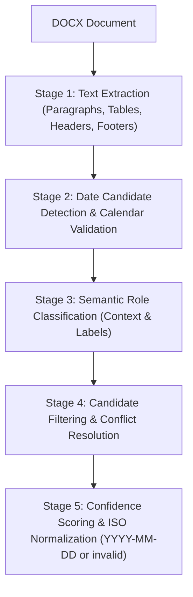

# ManuSure — Manuscript Received-Date Extraction and Automated Quality Testing

ManuSure is a robust, deterministic, production-grade command-line tool and automated quality assurance suite built to extract received dates from Microsoft Word (`.docx`) academic manuscripts. It extracts candidate dates, performs semantic role classification (distinguishing received dates from revised, accepted, published, and submitted dates), rigorously validates calendar dates (including leap years and month lengths), resolves conflicts, assigns confidence scores, and normalizes outputs to ISO 8601 (`YYYY-MM-DD`).

---

## 1. Project Overview

Academic publishers process manuscripts with varying layouts, styling, and editorial notations. ManuSure reads `.docx` documents—including body paragraphs, table cells/rows, headers, and footers—to pinpoint when a manuscript was originally received. When an unambiguous, valid received date is verified, it outputs the date in standard `YYYY-MM-DD` format. When a reliable received date cannot be established, it produces the literal string `invalid`.

Key Highlights:
- **Zero Cloud / AI Dependencies**: Runs 100% offline using deterministic rule-based NLP and calendar validation.
- **Resilient Batch Processing**: Corrupt, unreadable, or empty files produce `invalid` without terminating or affecting other manuscripts in the batch.
- **Strict Ambiguity Handling**: Ambiguous numeric dates (e.g., `01/02/2025`) and conflicting received dates produce `invalid`.
- **Confidence Scoring Engine**: Internal scoring based on label strength, format precision, contextual proximity, and candidate agreement.

---

## 2. Python Version Requirements

- **Target Python Version**: Python 3.12 (compatible with Python 3.11+)
- **Operating System**: Clean Ubuntu Linux (tested and verified on Windows with Git Bash / Linux environments)
- **Dependencies**: Minimal footprint defined in [`requirements.txt`](file:///requirements.txt):
  - `python-docx>=1.1.0`
  - `python-dateutil>=2.8.2`
  - `pytest>=8.0.0`

---

## 3. Installation Instructions

Clone the repository and install the dependencies in a virtual environment:

```bash
# Clone the repository
git clone <repository_url>
cd "tnq final"

# (Optional) Create and activate a virtual environment
python3 -m venv .venv
source .venv/bin/activate  # On Windows: .venv\Scripts\activate

# Install required dependencies
pip install -r requirements.txt
```

---

## 4. Repository Structure

```text
ManuSure/
├── run.sh                     # Executable Bash script for automated evaluation
├── main.py                    # Command-line entrypoint
├── requirements.txt           # Minimal dependencies
├── README.md                  # Comprehensive documentation
├── test_report.csv            # QA test report generated from actual execution
├── generate_test_report.py    # Report generator running verified checks
├── manusure/                  # Core extraction library
│   ├── __init__.py            # Package exports
│   ├── models.py              # Data classes and enums
│   ├── docx_reader.py         # DOCX parser for paragraphs, tables, headers, footers
│   ├── date_validator.py      # Calendar validation, leap years, candidate search
│   ├── nlp_extractor.py       # Context analyzer, role classifier, conflict resolver
│   ├── confidence.py          # Confidence scoring rules and thresholds
│   └── core.py                # Public APIs: extract_received_date & process_directory
└── tests/                     # Automated test suite (pytest)
    ├── __init__.py
    ├── conftest.py            # Dynamic DOCX fixtures and corrupt file helpers
    ├── test_extraction.py     # Semantic role and competing label tests
    ├── test_date_formats.py   # Date format variations and calendar bounds
    ├── test_edge_cases.py     # Conflicting dates, identical mentions, whitespace
    ├── test_docx_processing.py# Tables, headers, footers, corruption resilience
    └── test_cli.py            # CLI argument handling, exit codes, CSV schema
```

---

## 5. How to Execute `run.sh`

The primary submission interface is `run.sh`, which automatically verifies arguments, ensures the input folder exists, installs missing dependencies if required, and executes the extraction engine.

### Permissions
Ensure executable permissions are set:
```bash
chmod +x run.sh
```

### Execution Syntax
```bash
./run.sh <input_folder> <output.csv>
```

### Example Command
```bash
./run.sh ./manuscripts ./output.csv
```

### Direct Python Execution
Alternatively, execute the Python CLI directly:
```bash
python main.py ./manuscripts ./output.csv
```

---

## 6. Input and Output CSV Formats

### Input Folder
- A folder containing Microsoft Word `.docx` documents.
- Only `.docx` files directly inside the input folder are processed (non-recursive).
- Temporary lock files starting with `~$` are automatically ignored.
- Deterministic alphabetical order is applied to all input files.

### Output CSV Schema
The output CSV contains exactly two columns with UTF-8 encoding:

```csv
file,received_date
manuscript1.docx,2025-01-15
manuscript2.docx,2024-11-20
manuscript3.docx,invalid
```

- `file`: Basename of the manuscript file (never an absolute path).
- `received_date`: Valid normalized date in `YYYY-MM-DD` format or the literal string `invalid`.
- Internal diagnostics, evidence strings, and confidence scores are never exposed in the public CSV.

---

## 7. How Received-Date Extraction Works

The extraction engine follows a 5-stage deterministic pipeline:



1. **Stage 1: DOCX Text Extraction**
   - Extracts all text from paragraphs, table cells, concatenated table rows (`Column1: Column2`), and section headers and footers.
   - Any corruption or zip error is caught safely, returning `invalid` for that file without failing the batch.

2. **Stage 2: Date Candidate Detection & Validation**
   - Scans text blocks for date patterns.
   - Strictly validates calendar dates: year range (1900–2099), month bounds (1–12), day bounds for each month, and leap years (e.g., February 29).

3. **Stage 3: Semantic Role Classification**
   - Examines preceding context and trailing modifiers for each candidate date.
   - Labels candidates into semantic categories:
     - `RECEIVED`: Explicit labels (`Received:`, `Date received:`, `Manuscript received:`, `Rec.:`, `Manuscript was received on...`, `15 Jan 2025 (received)`).
     - `REVISED`: `Revised:`, `Revised on:`, `Received in revised form:`, `Revision received:`, `Resubmitted:`.
     - `ACCEPTED`: `Accepted:`, `Date accepted:`, `Approved:`.
     - `PUBLISHED`: `Published online:`, `Available online:`, `Publication date:`.
     - `SUBMITTED`: `Submitted:`, `Submission date:`.
     - `AMBIGUOUS`: `Date:`, `Dated:`.
     - `UNRELATED`: Generic citations or body sentences without date labels.

4. **Stage 4: Deterministic Conflict Resolution**
   - If no candidate has role `RECEIVED`: returns `invalid`.
   - If a candidate with role `RECEIVED` has an invalid calendar date (e.g. `Received: 35 January 2025`): returns `invalid`.
   - If an ambiguous numeric date is labelled as received (e.g. `Received: 01/02/2025`): returns `invalid`.
   - If multiple candidates have role `RECEIVED`:
     - If all agree on the same date: accepts that date.
     - If candidates specify different dates: returns `invalid` (conflicting received dates).

5. **Stage 5: Normalization & Confidence Assignment**
   - Normalizes accepted dates to `YYYY-MM-DD`.
   - Calculates confidence scores for internal diagnostics.

---

## 8. Supported Date Formats

ManuSure supports common international manuscript date conventions:

| Category | Example Input | Normalized Output | Notes |
| :--- | :--- | :--- | :--- |
| **Day Month Year** | `15 January 2025` | `2025-01-15` | Full textual month |
| **Day Month Year (Abbr)** | `15 Jan 2025` | `2025-01-15` | Abbreviated month |
| **Hyphenated DMY** | `15-Jan-2025` | `2025-01-15` | Hyphen-separated |
| **Ordinal Suffixes** | `15th January 2025` | `2025-01-15` | `st`, `nd`, `rd`, `th` suffixes supported |
| **Month Day Year** | `January 15, 2025` | `2025-01-15` | US standard format |
| **Month Day Year (Abbr)** | `Jan 15, 2025` | `2025-01-15` | Abbreviated month with optional period |
| **ISO 8601** | `2025-01-15` | `2025-01-15` | Hyphens, slashes, or dots |
| **Numeric Unambiguous** | `15/01/2025` | `2025-01-15` | Day > 12 resolves DD/MM/YYYY |
| **Numeric Unambiguous** | `05/05/2025` | `2025-05-05` | Day equals Month |
| **Leap Year** | `29 February 2024` | `2024-02-29` | Validated leap year |

---

## 9. Rules for Ambiguous and Conflicting Dates

In strict compliance with the assessment specification:

1. **Ambiguous Numeric Dates**:
   - Dates such as `01/02/2025` where both Day $\le$ 12 and Month $\le$ 12 and Day $\ne$ Month cannot be resolved without assuming an unstated publisher convention. ManuSure flags these as ambiguous and returns `invalid`.
2. **Conflicting Received Dates**:
   - If a manuscript contains two or more conflicting received dates (e.g., `Received: 15 January 2025` and `Received: 20 February 2025`), the conflict cannot be safely resolved. ManuSure returns `invalid`.
3. **Multiple Identical Mentions**:
   - If the same received date is repeated consistently (e.g., in the header and in the first page footnote), ManuSure accepts the date with high confidence.
4. **Malformed Received Dates**:
   - If a date explicitly labelled as received contains an impossible calendar date (e.g. `Received: 35 January 2025`), ManuSure returns `invalid` rather than falling back to an unrelated date.
5. **Competing Dates Without Received Date**:
   - If a manuscript contains only `Revised: 20 February 2025` or `Accepted: 10 March 2025` without a received date, ManuSure returns `invalid`.
6. **Ambiguous Labels**:
   - An ambiguous label like `Date: 15 January 2025` without the keyword `received` is not assumed to be a received date and returns `invalid`.

---

## 10. Confidence-Scoring Methodology and Thresholds

Confidence scores assess extraction reliability and assist diagnostics:

### Scoring Factors:
- **Base Score from Label Strength**:
  - Direct explicit label (`Received:`, `Date received:`, `Manuscript received:`): `0.90 – 0.95`
  - Contextual sentence (`This manuscript was received on...`): `0.85`
  - Abbreviated label (`Rec.:`): `0.75 – 0.85`
- **Format Quality**:
  - Full textual month name or ISO format: `+0.05`
  - Abbreviated month name: `+0.03`
  - Unambiguous numeric (`15/01/2025` where day > 12): `+0.00`
- **Agreement & Structure**:
  - Multiple independent mentions agreeing on the same date: `+0.05`
  - Structural metadata location (table or header): `+0.02`
- **Immediate Invalidation (Score = 0.0)**:
  - Conflicting received dates.
  - Invalid calendar date.
  - Ambiguous numeric date.
  - No received date found.

### Documented Confidence Levels:
- **High**: Score $\ge 0.80$
- **Medium**: $0.50 \le \text{Score} < 0.80$
- **Low**: $\text{Score} < 0.50$ (automatically outputs `invalid`)

---

## 11. How to Run Automated Tests

The test suite is built on `pytest` and contains 74 automated tests covering date formats, semantic roles, document processing, edge cases, and CLI integration.

Execute the test suite with:
```bash
python -m pytest -v
```

All 74 tests execute and pass without requiring external services or network access.

---

## 12. How to Regenerate `test_report.csv`

The QA test report [`test_report.csv`](file:///test_report.csv) records independent expected vs actual values across 58 quality checks.

To regenerate the report from live execution:
```bash
python generate_test_report.py
```

### Report Format
```csv
checks,input,expected,actual,result
Explicit received date (Full month),Received: 15 January 2025,2025-01-15,2025-01-15,PASS
Abbreviated month received date,Received: 15 Jan 2025,2025-01-15,2025-01-15,PASS
Ambiguous numeric date (01/02/2025),Received: 01/02/2025,invalid,invalid,PASS
Invalid calendar date (Day 35),Received: 35 January 2025,invalid,invalid,PASS
Revised date only (No received),Revised: 20 February 2025,invalid,invalid,PASS
```

---

## 13. Known Limitations and Edge Cases

1. **Non-DOCX Formats**: The tool strictly processes `.docx` files. Legacy binary `.doc` files (Word 97–2003) or PDFs are not supported.
2. **Scanned Images**: Text embedded purely as raster images inside Word documents cannot be extracted without an OCR engine.
3. **Dual Ambiguous Numeric Dates**: Pure numeric dates where both day and month are $\le 12$ and distinct (e.g. `02/03/2024`) are intentionally treated as `invalid` to avoid silent date corruption.
4. **Subdirectories**: As required by the specification, only eligible files directly inside the specified folder are processed (non-recursive).

---

## 14. Expected Behavior Summary Table

| Input Condition | Behavior | Output in CSV |
| :--- | :--- | :--- |
| Valid DOCX with single received date | Normalizes to `YYYY-MM-DD` | `YYYY-MM-DD` |
| Valid DOCX with received + revised + accepted dates | Extracts received date | `YYYY-MM-DD` |
| Multiple identical received dates | Returns the agreed date | `YYYY-MM-DD` |
| Conflicting received dates | Rejects ambiguity | `invalid` |
| Only revised / accepted / published dates | Distinguishes roles | `invalid` |
| Unrelated dates in body paragraphs | Rejects unlabelled dates | `invalid` |
| Malformed calendar date (e.g. 35 Jan) | Rejects invalid calendar | `invalid` |
| Ambiguous numeric date (e.g. 01/02/2025) | Rejects ambiguous date | `invalid` |
| Empty DOCX document | Handles gracefully | `invalid` |
| Corrupted / unreadable DOCX document | Catches error, continues batch | `invalid` |
| Temporary Word files (`~$*.docx`) | Excluded from processing | *(Skipped)* |
